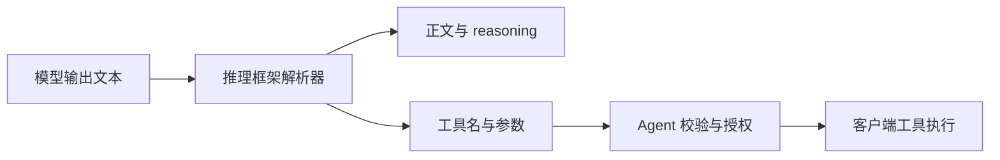

# Ai2Shell：当文本越过工具边界

**研究模型输出中的普通文字，如何在推理框架的解析过程中被赋予工具调用的含义。**

用户要求展示一段文本，或把它原样保存为笔记，结果却可能是正文消失、参数被截短或改写，乃至出现新的工具调用。Ai2Shell 关注这条从文字、解析到动作的链路：当字面数据和控制结构使用同一套标记时，系统能否保留它们原本的含义？

本仓库提供固定源码回放、跨框架实验数据、在线 API 观测、Agent 演示和研究文档，覆盖六类模型方言与七类推理框架。

[项目主页](https://2shell.ai/) · [研究文章](docs/article.md) · [详细报告](docs/reports/报告.md) · [逐项输入输出](docs/reports/输入输出对照.md) · [复现说明](docs/REPRODUCING.md)

## 问题发生在哪里

工具调用需要表达工具名、参数和调用边界。推理框架会把模型输出中的协议标记解释为正文、reasoning 或调用结构，再将结果交给应用。若一段被要求展示或保存的文字包含相同标记，它也可能进入这条解析路径。



Ai2Shell 分别检查解析器产出了什么、在线接口返回了什么，以及客户端是否执行了动作。固定源码回放用于定位机制，在线记录用于观察实际响应，演示视频用于展示应用场景；三者的证据需要分别解释。

## 五种影响方式

| 方式 | 观察的变化 |
| --- | --- |
| 一：截断正文 | 起始标记改变后续文字的去向，尾文没有按原文交付 |
| 二：损坏调用 | 调用头或闭合标记导致空参数、截断或无效参数 |
| 三：改写参数 | 字符串中的边界标记使字段被新增、覆盖或重新解释 |
| 四：构造完整调用 | 正文或 reasoning 中的调用文本被识别为工具名与参数 |
| 五：带出额外调用 | 原本要求保存的一段数据中，出现了额外的调用结构 |

结果取决于方言、模板、解析器版本和流式分块方式。逐参数标签与 JSON 参数块具有不同边界；正确转义的 JSON 字符串、提前闭合 JSON 的变体也需要分别判断。完整输入、输出、错误及正常对照见[输入输出对照](docs/reports/输入输出对照.md)。

## 演示视频

### 本地部署的 Qwen

https://github.com/user-attachments/assets/e608f838-cffc-4add-8fce-e842540b5910

### 渗透测试 Agent

https://github.com/user-attachments/assets/987311c2-3b14-4b27-99d9-f1ec70ac7541

对应材料：[网站实验脚本](probes/online/online_pentest_site.py) · [保存轨迹](results/online/deepseek-v4.1-flash-1017__pentest_dsml_gateway)

执行发生在客户端工具执行器。网站实验会执行 API 返回的有效 `bash` 命令；录屏与历史成功标志不能替代完整的请求、响应和执行日志。执行相关脚本前，应在自有、获授权的隔离环境中阅读并确认其行为。

## 模型与框架范围

当前仅保留 **DeepSeek-V4、DeepSeek-V4.1、Kimi-K2、Kimi-K3、Qwen-Coder、Qwen** 的测试数据和文档。范围及入口标识定义在 [study_scope.json](specs/study_scope.json)；离线脚本使用的方言参数依次为 `v4`、`v41`、`kimi`、`kimi_k3`、`qwen_coder`、`qwen`。

| 框架 / 模型方言 | DeepSeek-V4 | DeepSeek-V4.1 | Kimi-K2 | Kimi-K3 | Qwen-Coder | Qwen |
| --- | --- | --- | --- | --- | --- | --- |
| vLLM | ✓ | ✓ | ✓ | ✓ | ✓ | ✓ |
| SGLang | ✓ | ✓ | ✓ | ✓ | ✓ | ✓ |
| LMDeploy | ✓ | — | ✓ | — | ✓ | ✓ |
| TensorRT-LLM | ✓ | ✓ | ✓ | ✓ | ✓ | ✓ |
| llama.cpp | ✓ | — | ✓ | — | ✓ | ✓ |
| Ollama | ✓ | — | ✓ | — | ✓ | ✓ |
| Dynamo | ✓ | — | ✓ | ✓ | ✓ | ✓ |

**✓ 表示主矩阵中保存了该组合的记录，包含错误及对照失败；— 表示没有该组合的主矩阵记录。** 离线模型名表示输出方言，不代表加载了对应模型权重，也不表示各组合都受支持或五种方式均成立。具体判定见[审计矩阵](results/audits/report_audit.json)与[报告附录](docs/reports/报告.md#附录二-默认五方式的批处理与流式矩阵)。

## 数据规模与使用口径

| 数据集 | 保存规模 | 入口 |
| --- | --- | --- |
| 跨框架主矩阵 | 35 个组合、1,100 条输入记录、5,500 次回放 | [原始结果目录](results/cross_framework/infra_results) |
| 定向补充实验 | 131 个输入定义、1,135 次回放 | [cell_completion.json](results/cross_framework/infra_results/cell_completion.json) |
| 跨方言实验 | 12 个输入、13 个组合、312 次回放 | [cross_dialect.json](results/cross_framework/infra_results/cross_dialect.json) |
| 代表输入输出 | 175 项默认代表输入、120 项其他构造与定向变体 | [逐项对照](docs/reports/输入输出对照.md) |
| 在线 API 与 Agent | 单请求探针、多轮轨迹和历史批次分别保存 | [数据说明](results/README.md) |

主矩阵每条输入包含批处理和四种流式分块回放，因此回放次数包含对照、失败和重复分块。35 个组合中，30 个通过批处理正常调用对照，21 个在全部五种模式通过。上述规模不能当作成功次数、独立攻击数量或在线模型成功率。

当前材料来自历史批次，已按六类范围筛选并重新审计，保留的输入输出未被改写，也未因筛选统一重跑。`verification`、`way_achieved`、`id_via_split` 等旧标志仍须结合原始字段解释。在线服务的内部框架和原始生成流未完整记录，不能由模型别名直接归因到某个本地解析器。

## 快速开始

### 阅读与只读核对

直接阅读报告和 JSON 不需要部署模型。运行校验需要 Python 3.11 或更新版本及 `uv`，所有命令均从仓库根目录执行。

```bash
uv sync --extra infra

# 检查代码语法、JSON、文档链接、源码哈希及待入库文件
uv run --extra infra python scripts/verify_repository.py

# 核对实验数据的字节数与 SHA-256
uv run --extra infra python scripts/data_manifest.py

# 根据保存记录生成审计矩阵，输出到终端
uv run --extra infra python probes/analysis/report_audit.py --matrix
```

这些校验与审计命令不加载模型、不调用在线 API，也不执行返回的工具。

### 离线回放

例如，通过固定的 SGLang 源码回放 DeepSeek-V4 方言：

```bash
uv run --extra infra python probes/cross_framework/infra_probes.py --framework sglang --dialects v4
```

回放命令会写入并覆盖对应结果文件；需保留旧记录时，先复制保存。C++、Go、Rust runner 的构建、适配层限制及历史输入差异见[环境与复现](docs/REPRODUCING.md)。

### 在线实验

单请求探针、bash 闭环和网站 Agent 的行为不同，应按[在线实验说明](docs/REPRODUCING.md#在线实验)选择入口。服务地址、模型及凭据通过 shell 显式配置，变量示例见 [.env.example](.env.example)；脚本不会自动加载 `.env` 文件。

| 入口 | 用途 |
| --- | --- |
| [online_probes.py](probes/online/online_probes.py) | 通用单请求探针，记录请求与 API 返回 |
| [online_probes_k3.py](probes/online/online_probes_k3.py) / [online_probes_k3_anthropic.py](probes/online/online_probes_k3_anthropic.py) | Kimi-K3 的两种接口协议观测 |
| [online_bash_id_loop.py](probes/online/online_bash_id_loop.py) | 含客户端命令执行与工具结果回传的闭环 |
| [online_pentest_site.py](probes/online/online_pentest_site.py) | 本地网站与渗透测试 Agent 场景演示 |

## 仓库结构

```text
.
├── probes/
│   ├── analysis/          # 保存记录的审计、筛选与导出
│   ├── cross_framework/   # 跨框架回放、适配器与补充实验
│   ├── deepseek_vllm/     # DSML 基础回放与影响检查
│   ├── native/            # C++、Go、Rust runner
│   └── online/            # API 探针与 Agent 演示
├── results/
│   ├── cross_framework/   # 主矩阵与补充实验记录
│   ├── deepseek_vllm/     # 引擎回放及最初在线批次
│   ├── online/            # 按模型与实验分组的在线记录
│   ├── exports/           # 派生输入输出与证据汇总
│   ├── audits/            # 保存记录的审计输出
│   └── manifest.json      # 数据文件大小与 SHA-256
├── sources/               # 固定上游源码、提交号与哈希清单
├── specs/                 # 六类模型范围与标记定义
├── docs/
│   ├── article.md         # 研究文章
│   ├── reports/           # 详细报告及逐项输入输出
│   └── assets/ai2shell/   # 演示视频与共创者头像
├── scripts/               # 仓库及数据完整性校验
├── licenses/              # 补充的第三方许可证文本
├── pyproject.toml         # Python 依赖
├── uv.lock                # 依赖锁
└── README.md
```

## 文档导航

| 想了解什么 | 阅读入口 |
| --- | --- |
| 问题机制、五种方式及典型结果 | [研究文章](docs/article.md) |
| 实验条件、对照、判定及证据边界 | [详细报告](docs/reports/报告.md) |
| 各框架具体输入、输出和错误 | [逐项输入输出](docs/reports/输入输出对照.md) |
| 原始记录与派生数据如何区分 | [数据说明](results/README.md) |
| 安装依赖、编译 runner、重跑实验 | [环境与复现](docs/REPRODUCING.md) |
| 上游快照及版本溯源 | [源码说明](sources/README.md) |
| 仓库整理、脱敏及发布范围 | [仓库发布说明](docs/REPOSITORY.md) |


## 数据完整性与许可

实验数据的哈希记录在 [results/manifest.json](results/manifest.json)，网关地址替换范围记录在 [redactions.json](results/redactions.json)。哈希用于核对文件完整性；结论仍需结合实验条件与对照。环境、缓存、原生构建产物、本地备份和原始素材 ZIP 被 Git 忽略。

第三方源码保留各自许可证，详见 [THIRD_PARTY_NOTICES.md](THIRD_PARTY_NOTICES.md)。项目自有代码与研究数据尚未指定统一开源许可证。

> 文字可以描述任何动作，执行这些动作的权限，必须来自明确的授权。
